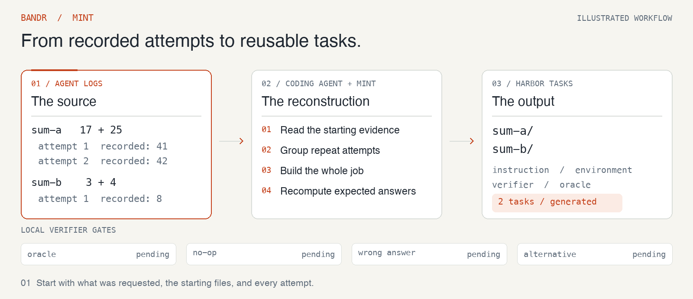
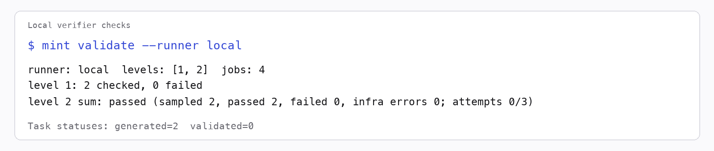

<div align="center">

# Bandr

### Agent logs in. Runnable tasks out.

Build evals and training environments from the work your agents already do.

[](https://github.com/bandr-ai/bandits/actions/workflows/quality.yml)
[](pyproject.toml)
[](#quickstart)

[**Get started**](#quickstart) &nbsp;·&nbsp; [How it works](#how-it-works) &nbsp;·&nbsp; [Try the example](#try-it-on-three-traces) &nbsp;·&nbsp; [Guides](#documentation)

</div>

<picture>
  <source media="(prefers-reduced-motion: reduce) and (prefers-color-scheme: dark)" srcset="docs/assets/readme/mint-workflow-dark.png">
  <source media="(prefers-reduced-motion: reduce)" srcset="docs/assets/readme/mint-workflow-light.png">
  <source media="(prefers-color-scheme: dark)" srcset="docs/assets/readme/mint-workflow-dark.webp">
  
</picture>

<p align="center"><sub>Illustrated from the <a href="examples/mint">runnable example</a>. Local verifier checks shown. <a href="docs/assets/readme/mint-workflow-light.png">Still image</a>.</sub></p>

Your agent failed a job. The trace records what happened. **Can another agent try
that same job, from the same starting state, with a test for the right outcome?**

Mint is the CLI inside Bandr that helps a coding agent build that task. It reads
the evidence, groups repeat attempts, and packages the original request, starting
environment, and verifier in [Harbor's task format](https://github.com/harbor-framework/harbor).
Successful attempts are useful too; the logged answer is never assumed correct.

## Quickstart

**Install Bandr. Give your coding agent the Mint skill. Point it at your logs.**

```bash
pip install bandr
mint skill install
```

<sub>First release pending: until Bandr is published on PyPI, install this checkout with <code>pip install .</code>. Python 3.11+.</sub>

Start a new Claude Code session and ask:

```text
Use Mint to turn ./logs into Harbor tasks in ./mint-workspace.
Inspect the source first, build a few tasks, then validate and report.
```

The skill goes into `~/.claude/skills/mint/`. Use `mint skill install --project`
for the current project's `.claude/skills/mint/`. Other coding agents can read
[SKILL.md](mint/SKILL.md) directly.

<details>
<summary>Other install options and updating the skill</summary>

For an isolated CLI installation, use `uv tool install bandr` or
`pipx install bandr`. For local development, run `uv sync --extra dev` and use
`uv run mint ...` to run this checkout.

After upgrading, re-run `mint skill install`. If the installed skill differs,
review it and use `--force` to replace `SKILL.md`; other files are preserved.

</details>

## When to use Mint

| You have | You want | Mint helps you build |
| :--- | :--- | :--- |
| Failed or successful agent traces | Repeatable tests of the same work | Whole-job tasks with starting files and outcome checks |
| Several attempts at one job | One task with all attempts as evidence | Grouped instances with source references |
| Traces plus an existing harness | Tasks for evaluation or training rollouts | Harbor packages that reuse the supplied environment |

Bring the starting-state files or harness when you have them. Missing evidence
becomes a recorded gap or a candidate to finish, rather than an invented environment.

## How it works

**The coding agent writes source-specific code. Mint runs it over the corpus and
records the evidence.**

| Step | What happens |
| :--- | :--- |
| **Read** | Sample the logs, write a parser, and identify the whole jobs the agent was given. |
| **Rebuild** | Group repeated attempts and construct each job's instruction, starting environment, verifier, and oracle when available. |
| **Challenge** | Check structure, answer leaks, and credentials. Exercise the verifier with the oracle, no-op, wrong outcomes, and valid alternatives. |
| **Report** | Inspect task provenance, gate results, exclusion reasons, and gaps. Resume from `mint status`. |

The output is a task package you can inspect:

```text
out/tasks/<type>/<task>/
├── instruction.md          # the original job
├── environment/            # the world before the agent acted
├── tests/test.sh           # check the requested outcome
├── solution/solve.sh       # optional oracle
└── task.toml               # runtime configuration and provenance
```

The verifier checks the outcome; it does not require a new agent to replay the
logged steps. Mint can also build dialogue tasks with a runtime user simulator,
or use a model judge when deterministic grading is unsuitable.

## Try it on three traces

The [bundled example](examples/mint) contains three synthetic attempts at two
jobs. Two recorded answers are wrong. Its generator recomputes the expected
answers from the starting files and builds two tasks.

**Run it yourself:** [logs → parser → task generator → validation → report](examples/mint/README.md).
No model calls or production logs are needed.

<picture>
  <source media="(prefers-color-scheme: dark)" srcset="docs/assets/readme/mint-checks-dark.png">
  
</picture>

Local checks leave tasks **`generated`**. Install Harbor and start Docker, then
run `mint validate --runner harbor` for container execution. Only passing Harbor
execution gates can produce **`validated`**. The example's answer oracle proves
verifier wiring; inspect that the expected answer follows from the inputs.

<details>
<summary>Validation statuses, sensitive data, and what passing gates prove</summary>

| Status | Meaning |
| :--- | :--- |
| `generated` | Structure and content gates passed; execution may be local-only, untested, or missing an oracle. |
| `validated` | Required Harbor execution gates passed, including an accepted oracle and rejected no-op/wrong outcomes. |
| `judged` | A model grades the task. Inspect calibration and execution evidence; it is never called validated. |
| `blocked` | A content scan found an answer leak or credential. Credential-blocked packages are removed from `out/tasks`; fix and regenerate. |
| `exec_failed` | Structure, execution gates, or a type audit failed. Inspect the reason. |

Passing gates are evidence about the verifier, not proof that the expected answer
is correct or the reconstructed task is faithful. Review the source references,
grading trust, oracle provenance, and gaps in `report.md`.

The secret scan is best-effort text scanning. Binary and explicitly allowed files
are outside it; raw logs, parsed trajectories, and internal metadata can remain
sensitive. See the [validation guide](mint/guides/validation.md).

</details>

## Documentation

| Start here | For |
| :--- | :--- |
| [Mint skill](mint/SKILL.md) | The full agent-assisted workflow |
| [Parsing](mint/guides/parsing.md) · [Checks](mint/guides/checks.md) | Reading your source format and optional findings |
| [Task types](mint/guides/tasktypes.md) | Building whole jobs, environments, and verifiers |
| [Validation](mint/guides/validation.md) · [Harbor](mint/guides/harbor.md) | Execution gates and runtime integration |

Run `mint --help`, `mint schema`, and `mint docs` for the installed version's
commands and contracts. [Open an issue](https://github.com/bandr-ai/bandits/issues)
for a bug or a conversion case you cannot represent.

<details>
<summary>Development, releases, and older recipes</summary>

```bash
uv sync --extra dev
uv run ruff check bandits mint tests
uv run ruff format --check bandits mint tests
uv run pytest tests
```

The distribution is `bandr`; Python imports remain `mint` and `bandits`.
`bandits` provides the ingestion library. See [releasing](docs/releasing.md) and
[the changelog](CHANGELOG.md). Older [SFT](recipes/data/sft) and [JEV](recipes/jev)
recipes are retained for reference.

[Visual source and build instructions](docs/assets/readme/README.md).

</details>

<sub>Anonymous command usage is enabled by default. No log contents or paths are sent. Disable it with <code>mint telemetry off</code> or <code>MINT_TELEMETRY_DISABLED=1</code>. <a href="mint/telemetry.py">Details</a>.</sub>
